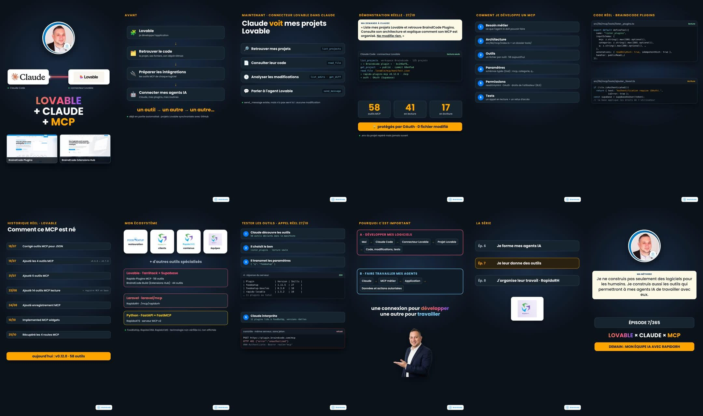

# Épisode 7 — Storyboard

| Vignette | Temps | Scène | Source visuelle |
|---|---|---|---|
| 1 | 0–8,7 s | Hook : portrait, Claude ↔ Lovable, « LOVABLE + CLAUDE + MCP », 2 projets | photo réelle, logos officiels, `captures/lovable-*.png` |
| 2 | 8,7–18,1 s | Avant : 4 étapes, « un outil → un autre » | composition |
| 3 | 18,1–26,2 s | Les 5 outils du connecteur Lovable | noms réels des outils |
| 4 | 26,2–38,2 s | Demande + appels réels + 58 / 41 / 17 + OAuth | résultats des appels du 27/10 |
| 5 | 38,2–48,6 s | Besoin → architecture → outils → paramètres → permissions → tests | manifeste et arborescence réels |
| 6 | 48,6–52,7 s | Code réel `lister_plugins.ts`, `ajouter_favori.ts` | `read_file` |
| 7 | 52,7–57 s | Historique réel 18/07 → 25/10 | `list_edits` |
| 8 | 57–73,5 s | Écosystème + technologies vérifiées | logos officiels, manifestes, code RapidoRH |
| 9 | 73,5–88,2 s | Test en 5 étapes + refus 401 | `lister_plugins`, `captures/test-refus-401.txt` |
| 10 | 88,2–102,4 s | Architectures A (développer) et B (travailler) | composition |
| 11 | 102,4–111,6 s | Ép. 6 → 7 → 8 | série |
| 12 | 111,6–120 s | Phrase finale, ÉPISODE 7/365, demain RapidoRH | photo réelle |
